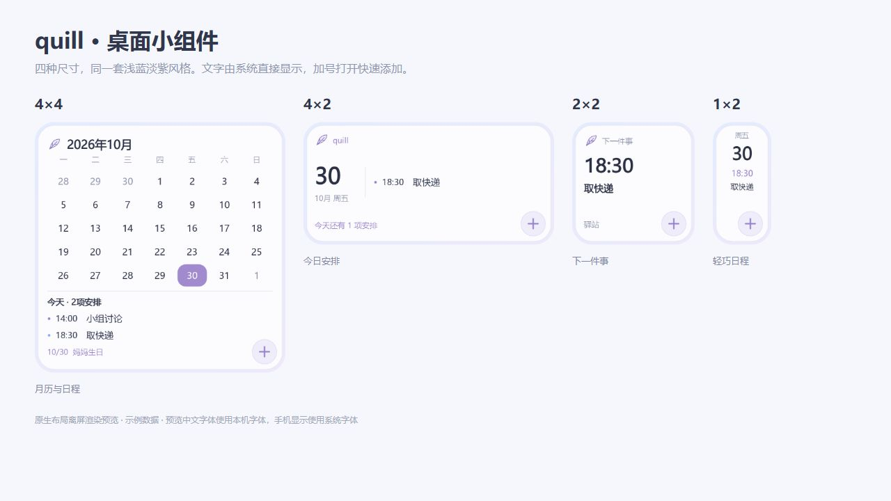

# quill · 离线语音日历

按住说“明天下午三点开组会”，quill 会在录音时显示转写文字。同一次长按中，右滑松手可以添加日程，左滑松手可以先改时间或标题。Android 端在手机上完成中文语音识别。



## 从一句话到桌面提醒

- **语音输入**　Kotlin 模块采集音频，通过 sherpa-onnx 调用 SenseVoiceSmall。后台识别生成录音预览，松手后对完整录音执行最终识别。直接松手保留文字，上滑取消。
- **日期与提醒**　TypeScript 解析中文日期、时间与重复规则，支持公历和农历生日。Android 原生模块负责通知和闹铃。
- **桌面小组件**　四种尺寸分别展示月历、今日安排、下一件事和紧凑摘要。保存、修改或删除日程后，应用更新原生缓存，桌面组件通过 RemoteViews 刷新。
- **数据与可选 AI**　日程保存在本地，支持备份和恢复。启用可选 AI 解析时，确认后的文本会发送给用户配置的服务。安卓离线语音识别本身无需 API 密钥。

## 运行 Web 预览

使用 Node.js 24.3+ 的 24.x 版本或 Node.js 26。项目版本为 0.1.5。

```sh
npm ci
npm run web
```

Web 版可以体验日历和文字添加流程。离线语音、系统闹铃和桌面小组件需在 Android 上体验。

## Android 本地调试

安装 Android SDK、项目所需的 JDK、Python 3 和 npm 依赖后，运行以下命令。准备脚本会下载并校验固定版本的推理库和模型，再提取 arm64-v8a 运行文件。第三方组件许可见 [THIRD_PARTY_NOTICES.md](THIRD_PARTY_NOTICES.md)。

```sh
python scripts/prepare-speech.py
npm run android -- --device
```

原生工程使用 `android/app/debug.keystore` 作本地调试签名。首次构建前可使用 JDK 生成自己的调试密钥：

```sh
keytool -genkeypair -keystore android/app/debug.keystore -storepass android -keypass android -alias androiddebugkey -keyalg RSA -keysize 2048 -validity 10000 -dname "CN=Android Debug,O=Android,C=US"
```

## 代码与验证

| 位置 | 内容 |
| --- | --- |
| [src/domain](src/domain) | 日期解析、重复规则、语音手势与小组件数据 |
| [src/services](src/services) | 本地存储、提醒、语音和可选 AI 适配 |
| [modules/qingri-device](modules/qingri-device) | Android 离线识别、闹铃、桌面小组件 |
| [tests](tests) | 日历规则、存储、界面交互与平台适配测试 |

`npm run check` 运行 TypeScript 检查和 90 项自动化测试。桌面小组件预览图来自 Android 原生布局的离屏渲染。
